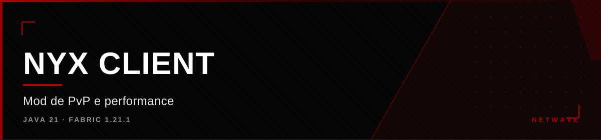

<div align="center">



</div>

<div align="center">

[](https://github.com/hiro0010/nyx-client) [](https://github.com/hiro0010/nyx-client) [](https://github.com/hiro0010/nyx-client) [](https://github.com/hiro0010/nyx-client)

</div>


## O que é

Client de Minecraft para **PvP competitivo e performance**, em Java sobre
o loader Fabric. São 38 módulos organizados em 6 categorias, com ClickGUI,
HUD custom, capas e integração com o Discord.

O foco é combate com timing e humanização de input — o difícil em PvP não é
reacher longe, é fazer as ações com ritmo plausível para um humano.

---

## Arquitetura

```
Fabric (Knot) → fabric.mod.json → clanClient.onInitializeClient()
  1. CapsManager.init()      → diretório de capas
  2. ModuloManager.init()    → registra os 38 módulos
  3. ConfigManager.load()    → configuração persistida
  4. Discord RPC             → presença no Discord
  5. auto-save (thread 30s)  → grava config periodicamente
  6. ScreenEvents            → tela de título custom
  7. ClientTickEvents        → loop principal
  8. registerHud()           → "[NYX] Pronto!"
```

- **Registry** por listas estáticas, com `init()` idempotente
- **Eventos** do Fabric para tick, render de HUD e render de mundo
- **Mixins** (`@Inject` em HEAD/TAIL/RETURN) com `defaultRequire=0` — uma
  falha de mixin não derruba o jogo; a integração é feita por lookup de nome
  no registry

### Loop de execução

A cada tick: guarda de janela → contador → controles (GLFW) → para cada módulo
ativo, `onTick()` dentro de try/catch com log. O Discord atualiza a cada 40
ticks; a configuração salva a cada 6000.

---

## Módulos (38)

| Categoria | Módulos |
|---|---|
| **HUD (15)** | FPS, Ping, TPS, Coords, Direção, Speed, CPS, Keystrokes, Armor, Potions, Animations, Performance, Zoom, Capas, Discord |
| **COMBAT (7)** | Reach, Hitbox, AimAssist, Backtrack, WTap, FakeLag, LagRang |
| **GHOST (2)** | SYS, BypassManager |
| **NYX / HELP (7)** | Sword, Mace, CristalHelper, Anchor, SyncTap, ClickSword, ClickMace |
| **PLAYER (2)** | FastPlace, AutoTotem |
| **MOVEMENT (3)** | Sprint, Strafe, Timer |
| **VISUAL (2)** | Nametags, FullBright |

**Backtrack** rebobina a posição do alvo e re-renderiza em 3D pulsante.
**FakeLag** e **LagRang** montam filas de pacotes de movimento com vários modos.
**AimAssist** humaniza o movimento com jitter e tempo de reação.
**BypassManager** traz presets para GRIM, POLAR, SPARTAN, MATRIX e VULCAN,
além de perfis STEALTH e BALANCED.

---

## Stack

| Camada | Tecnologia |
|---|---|
| Linguagem | Java 21 |
| Minecraft | 1.21.1 |
| Loader | Fabric 0.16.9 · Fabric API 0.116.10 |
| Mapeamento | Yarn 1.21.1+build.3 |
| Build | Gradle 8.11 + Fabric Loom 1.9.2 |
| Presença | DiscordIPC (jagrosh) |
| Performance | Sodium, Lithium, FerriteCore, ImmediatelyFast, EntityCulling, ModernFix |

Escala real: **92 arquivos `.java`, ~15,8 mil linhas, 19 mixins ativos.**

---

## Interface

ClickGUI com sidebar de 6 categorias, arrastar e scroll, aberto com
**Caps Lock + Alt + D**. Painel do HUD com **Right Shift**. Telas próprias de
Options, Video, Skin, Controls, Accessibility, Mouse, Singleplayer e
Multiplayer — com TitleScreen animada (partículas e efeito de máquina de
escrever).

---

## Configuração

`ConfigManager` serializa para JSON, aplica XOR com chave fixa e codifica em
Base64, gravando em `run/Nyx/cache.dat`. Auto-save a cada 30 segundos em
thread daemon, a cada 6000 ticks e no shutdown.

---

## Status

Funcional em desenvolvimento. Compila com Loom e roda. O jar final de
distribuição ainda não é gerado — o build atual para em `dev`.


<div align="center">

<sub>Parte da <a href="https://github.com/hiro0010/netwave">Netwave</a>
&middot; Owner: <a href="https://github.com/hiro0010">Hiro</a></sub>

</div>
